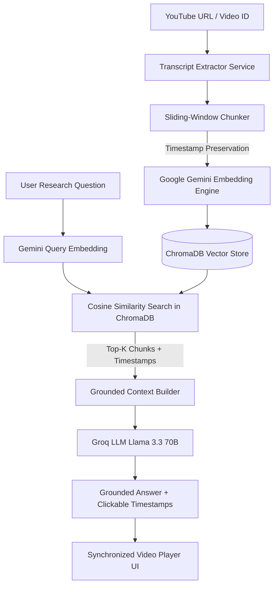

<div align="center">

# ⚡ YTRAG
### Grounded YouTube Video Research Assistant

[](https://python.org)
[](https://fastapi.tiangolo.com)
[](https://www.trychroma.com/)
[](https://groq.com)
[](https://ai.google.dev)
[](LICENSE)

An enterprise-ready **Grounded Retrieval-Augmented Generation (RAG)** system that ingests YouTube videos, generates high-dimensional semantic embeddings from timestamped transcripts, and answers research inquiries with **verifiable timestamp citations** synced directly to video playback.

</div>

---

## 🌟 Key Features

- **🎯 Zero Hallucination Policy**: Enforces strict grounding prompts. If the queried information is not explicitly spoken in the video transcripts, the assistant gracefully falls back rather than extrapolating.
- **⏱️ Timestamp Citation Alignment**: Every factual claim is mapped to the exact start and end seconds in the video (`[MM:SS - MM:SS]`).
- **🎬 Interactive Video Playback**: Click any citation chip to jump the embedded YouTube player directly to that segment with autoplay.
- **⚡ Hybrid Multi-Video Corpus**: Search across single targeted videos or query an entire multi-video knowledge base simultaneously.
- **🧠 Gemini Dense Embeddings**: Utilizes Google Gemini's `gemini-embedding-001` for accurate semantic representation across technical domains.
- **🚀 Ultra-Fast Inference with Groq**: Powered by Groq's LPU acceleration running high-parameter open models (`llama-3.3-70b-versatile`).
- **💾 Persistent Vector Storage**: Stores chunk vectors and metadata locally in ChromaDB with cosine similarity search.
- **🎨 Glassmorphic Dark UI**: Modern responsive web interface built with vanilla HTML/CSS and real-time player synchronization.

---

## 🏛️ System Architecture



---

## 📂 Project Structure

```
ytrag/
├── app/
│   ├── api/
│   │   ├── __init__.py
│   │   └── routes.py              # FastAPI endpoint definitions
│   ├── core/
│   │   ├── __init__.py
│   │   └── config.py              # Dataclass settings and environment loader
│   ├── db/
│   │   ├── __init__.py
│   │   └── vector_store.py        # Persistent ChromaDB collection manager
│   ├── models/
│   │   ├── __init__.py
│   │   └── schemas.py             # Pydantic contracts and DTOs
│   ├── prompts/
│   │   ├── __init__.py
│   │   └── templates.py           # Grounded RAG prompts & formatting helpers
│   ├── services/
│   │   ├── __init__.py
│   │   ├── chunking.py            # Sliding-window transcript chunker
│   │   ├── embeddings.py          # Gemini embedding generation
│   │   ├── rag.py                 # Grounded synthesis & citation resolver
│   │   └── transcript.py          # YouTube transcript & video ID parser
│   ├── static/
│   │   ├── app.js                 # Frontend interactive controller
│   │   ├── index.html             # Web application interface
│   │   └── style.css              # Glassmorphic dark styling
│   ├── __init__.py
│   └── main.py                    # Application entrypoint & CORS config
├── tests/
│   ├── __init__.py
│   ├── test_api.py                # API integration test suite
│   ├── test_chunking.py           # Chunker unit tests
│   └── test_transcript.py         # URL and ID extractor tests
├── .dockerignore
├── .env.example
├── .gitignore
├── Dockerfile
├── docker-compose.yml
├── LICENSE
├── pyproject.toml
├── requirements.txt
└── README.md
```

---

## 🚀 Quickstart Guide

### 1. Prerequisites
- Python 3.11+
- [Groq API Key](https://console.groq.com)
- [Google Gemini API Key](https://aistudio.google.com/)

### 2. Clone and Setup Environment

```bash
git clone https://github.com/vishesh-017/ytrag.git
cd ytrag

# Create and activate virtual environment
python -m venv .venv

# On Linux / macOS:
source .venv/bin/activate

# On Windows:
.venv\Scripts\activate

# Install dependencies
pip install -r requirements.txt
```

### 3. Configure API Credentials

Create a `.env` file from the provided `.env.example`:

```bash
cp .env.example .env
```

Edit `.env` with your API keys:

```ini
GROQ_API_KEY=gsk_your_groq_api_key_here
GEMINI_API_KEY=AIzaSy_your_gemini_api_key_here
GROQ_MODEL=llama-3.3-70b-versatile
GEMINI_EMBEDDING_MODEL=gemini-embedding-001
CHUNK_SIZE=1000
CHUNK_OVERLAP=200
```

### 4. Run Development Server

```bash
uvicorn app.main:app --reload --port 8000
```

Open your browser at **[http://localhost:8000](http://localhost:8000)** to launch the research assistant interface.

Interactive OpenAPI documentation is available at **[http://localhost:8000/docs](http://localhost:8000/docs)**.

---

## 🐳 Docker Deployment

You can run the entire service via Docker Compose:

```bash
docker compose up --build -d
```

The service will run on port `8000` with ChromaDB data persisted in a named volume (`chroma_data`).

---

## 📡 REST API Reference

| Method | Endpoint | Description |
| :--- | :--- | :--- |
| `GET` | `/api/health` | System health check and API key readiness |
| `POST` | `/api/index` | Ingest and index a YouTube video transcript |
| `POST` | `/api/ask` | Submit research question and receive grounded answer |
| `GET` | `/api/videos` | List all indexed videos and chunk counts |
| `DELETE` | `/api/videos/{video_id}` | Delete a video and its stored vectors from index |

### Sample Ask Request

```bash
curl -X POST "http://localhost:8000/api/ask" \
  -H "Content-Type: application/json" \
  -d '{
    "question": "What architecture trade-offs were discussed?",
    "video_id": "dQw4w9WgXcQ",
    "top_k": 4
  }'
```

---

## 🧪 Running Automated Tests

Run the test suite using `pytest`:

```bash
pytest
```

---

## 📄 License

This project is licensed under the [MIT License](LICENSE).
